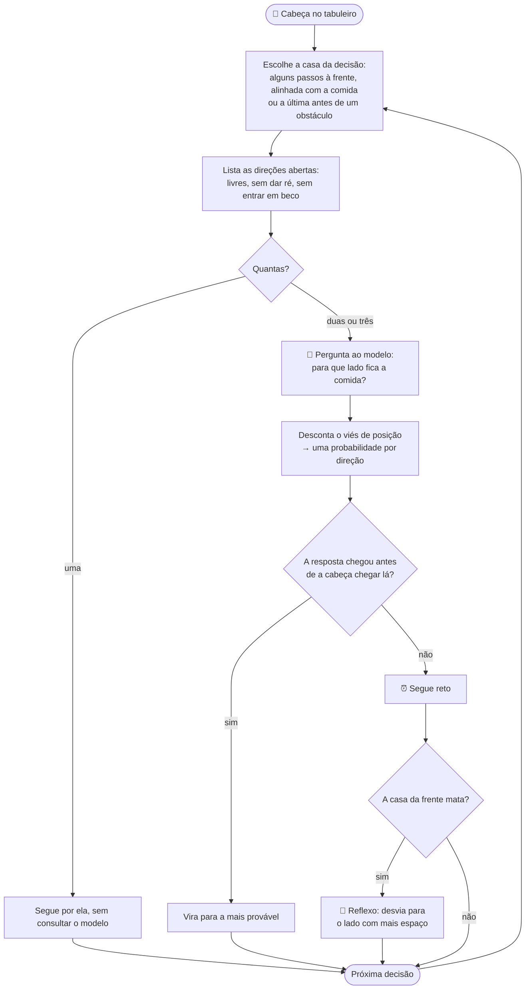

import ModelLoader from '@/components/blog/semif/ModelLoader.astro'
import Snake from '@/components/blog/semif/Snake.astro'

Nos outros jogos desta série o modelo ajuda você, como [plateia do Show do Milhão](/blog/llm-show-do-milhao), ou atrapalha, como [fantasma do Pac-Man](/blog/llm-pac-man-ghost). Aqui ele joga sozinho: a cada curva, a cobra pergunta ao modelo para que lado ir. Você assiste, mexe na velocidade e, se quiser, toma o controle.

A pergunta que eu queria responder era uma só:

> Um modelo de linguagem pequeno, rodando na placa de vídeo de quem abre a página, consegue jogar cobrinha?

A resposta é: **consegue, de graça, e um modelo que nem é de linguagem joga melhor.**

O resto do post é essa frase em três partes. Antes dela, o jogo.

## Carregue o cérebro 🧠

O fantasma do Pac-Man para na encruzilhada e espera a resposta do modelo. A cobra não espera: se a resposta não chegou, ela segue reto. Por isso a página começa no menor modelo. Aqui uma resposta rápida vale mais que uma resposta certa.

Sem modelo nenhum, a cobra vira ao acaso.

<ModelLoader prefer="fast" />

## Jogue 🐍

<Snake />

O controle 🐢 🐇 muda quantos passos a cobra dá por segundo. O modelo leva o mesmo tempo para responder em qualquer velocidade, então quanto mais rápido o jogo, mais longe da curva ele precisa decidir. É o jeito mais fácil de ver até onde ele aguenta: o painel conta as respostas que chegaram tarde (⏰) e as vezes em que a cobra só se salvou por reflexo (🫨).

O que acontece nesses dois casos é a primeira parte da resposta.

## Consegue 🔁

Cada curva passa pelo mesmo ciclo:

Nada nesse ciclo deixa o modelo mais esperto. Tudo nele serve para dar tempo a um modelo que não tem. Três detalhes fazem a cobra sobreviver:

- **🔮 Perguntar antes.** A resposta leva cerca de 0,3 s. Se a cobra perguntasse só na hora de virar, a resposta chegaria com ela já duas casas adiante.
- **⚖️ Descontar o viés.** O Qwen3 0.6B responde "A" com cerca de 99% de certeza para qualquer pergunta. Como "Up" era sempre a opção A, a primeira versão subia até bater na parede. A correção mede esse viés com uma pergunta sem informação e desconta de cada resposta.
- **🧱 Não oferecer becos.** O modelo só escolhe entre direções que não levam a um espaço menor que a própria cobra.

Dos três, só o segundo tenta melhorar a resposta. O primeiro compra tempo, e o terceiro tira da lista as respostas que matariam, para que nem a atrasada seja fatal. Dois detalhes em três cuidam do relógio, não do cérebro. A cobra não espera.

## De graça 💸

Para quem publica o site, sim. Não há chave de API nem servidor: o modelo roda na placa de vídeo de quem abre a página.

- **🏷️ O nome da tecnologia:** inferência de LLM no navegador, com [WebGPU](https://developer.mozilla.org/en-US/docs/Web/API/WebGPU_API). O motor é o [wllama](https://github.com/ngxson/wllama), o llama.cpp compilado para WebAssembly.
- **🎯 O nome da técnica:** leitura direta, a mesma da [primeira parte](/blog/llm-choices-in-the-browser). Em vez de escrever uma resposta, o modelo faz uma única passada e lemos a probabilidade de cada opção. O [SemIf](https://github.com/TheoLeeCJ/SemIf-OpenJev), de onde ela veio, chama isso de "if semântico".
- **🧾 Quem paga:** o visitante, com o download do modelo (639 MB a 3 GB), a placa de vídeo e a bateria.
- **🔗 Do que depende:** os modelos vêm do Hugging Face e o wllama vem do jsDelivr. Se um dos dois sair do ar, a demo para.
- **📜 Licenças:** SemIf e wllama são MIT. Os três modelos (Qwen3 0.6B, MiniCPM5 2B e Qwen3.5 4B) estão marcados como Apache-2.0 no Hugging Face.

Grátis, portanto, numa conta que o visitante paga em megabytes e em segundos. E segundos são justamente o que a cobra não tem. Daí a pergunta seguinte: para escolher entre três direções, existe algo mais rápido que um modelo de linguagem?

## E um modelo que nem é de linguagem joga melhor 🎼

### Jev e Laya 🥊

O SemIf nasceu para reproduzir, com modelos abertos, o que o Jev faz como serviço fechado. O Laya chega ao mesmo lugar por outro caminho: um modelo treinado só para decidir, sem gerar texto. Para uma cobra, a linha que interessa na tabela é a de velocidade.

<Wide>

| | 🧪 SemIf + wllama (este post) | 🏢 Jev | 🎼 Laya |
| --- | --- | --- | --- |
| **O que é** | LLM pequeno e genérico, lido pelas probabilidades | Serviço fechado da TypeSafe | Encoder treinado só para decidir, sem gerar texto |
| **📍 Onde roda** | No navegador do visitante | No servidor deles | No seu servidor (Python) ou no navegador, via ONNX (testado abaixo) |
| **💸 Preço** | Grátis | US$ 0,042 por milhão de tokens de entrada; saída grátis | Grátis, você hospeda |
| **🚪 Acesso** | Aberto | Acesso antecipado, com lista de espera | Aberto |
| **📜 Licença** | MIT (código), Apache-2.0 (modelos) | Fechado | Apache-2.0 (código e modelos) |
| **📦 Download** | 639 MB a 3 GB | Nenhum | 644 a 843 MB por modelo |
| **⚡ Velocidade** | ~0,3 s por decisão (medido aqui, Qwen3 0.6B) | 70 a 500 ms de ponta a ponta (blog da TypeSafe) | ~0,07 s por decisão no navegador (medido aqui); 33 ms numa GPU T4 (README) |
| **🎯 Qualidade publicada** | 84,5% no conjunto de teste da TypeSafe (Qwen3.5 4B) | 88,3% no mesmo conjunto | 78,3% em intenções em inglês (README) |

</Wide>

Como ler a tabela:

- **📅 Data:** preços e licenças consultados em 9 de outubro de 2026.
- **⚠️ Os números não se comparam entre colunas.** Cada um vem de um teste, de uma máquina e de um conjunto de perguntas diferente.
- **🏢 Jev:** o preço e a velocidade estão no [post de lançamento da TypeSafe](https://typesafe.ai/blog/introducing-system-one-models-and-jev). A cobrança é por token, não por decisão, e não achei página de preços nem plano gratuito oficial. Os 88,3% vêm dos registros que a própria TypeSafe publicou.
- **🎼 Laya:** o [README](https://github.com/NandhaKishorM/laya) avisa que os modelos saem confiantes demais e também têm viés de posição entre as opções. O pacote TypeScript ainda não está no npm e os repositórios oficiais não trazem os arquivos ONNX, então rodar no navegador depende de exportações feitas pela comunidade.

O Jev fica na tabela como referência: é fechado e roda no servidor deles, então não dá para colocar na cobra. O Laya dá.

### O Laya no lugar do LLM 🔁

Dá para trocar de motor sem recarregar a página: escolha **Laya multilingual** na lista de modelos lá em cima e clique em **Switch to**. Para voltar, escolha um dos outros. O jogo, as setas e o painel são os mesmos.

O que roda aqui é a [exportação ONNX da onnx-community](https://huggingface.co/onnx-community/laya-multilingual-ONNX), pelo Transformers.js, também na sua placa de vídeo.

| | 🧪 Qwen3 0.6B | 🎼 Laya multilingual |
| --- | --: | --: |
| **Tipo** | LLM | Encoder |
| **📦 Download** | 639 MB | 678 MB |
| **⚡ Tempo por decisão** | ~0,30 s | ~0,07 s |
| **🍎 Maçãs a 3 passos/s** | 8 em 40 s | 9 em 40 s |
| **🍎 Maçãs a 8 passos/s** | 0 em 30 s | 25 em 40 s |
| **🍎 Maçãs a 20 passos/s** | 2 em 30 s | 15 em 40 s |

- **🐢 Devagar, empatam.** A 3 passos por segundo os dois têm tempo de sobra para responder.
- **🐇 Rápido, o Laya some na frente.** Ele responde em um quarto do tempo, então decide mais perto da curva e não passa da comida.
- **🗣️ Cada um quer a pergunta do seu jeito.** Com a pergunta feita para o LLM ("para que lado você vai?"), o Laya acertou a direção em 20 de 36 testes. Perguntando o que o texto diz ("onde está a maçã?"), acertou 36 de 36. O jogo usa uma pergunta para cada motor.
- **⚠️ É uma amostra pequena.** Foi uma partida por velocidade, na minha máquina, e as rodadas rápidas do Qwen duraram 30 segundos em vez de 40.

O Laya não ganha por saber mais sobre cobrinha: devagar, os dois empatam. Ganha porque chega antes. A cobra não espera.

## A resposta 🏁

Então, um modelo de linguagem pequeno consegue jogar cobrinha?

Consegue, com três truques que servem para dar tempo a ele: perguntar antes, descontar o viés e não oferecer becos. De graça, numa conta que o visitante paga em download e bateria. E um encoder de 678 MB, que não escreve uma palavra, joga melhor nas velocidades altas, porque responde em um quarto do tempo.

Se você for fazer a sua, comece pelos três truques. E, antes de trocar por um modelo maior, olhe o contador ⏰. A cobra não espera.
